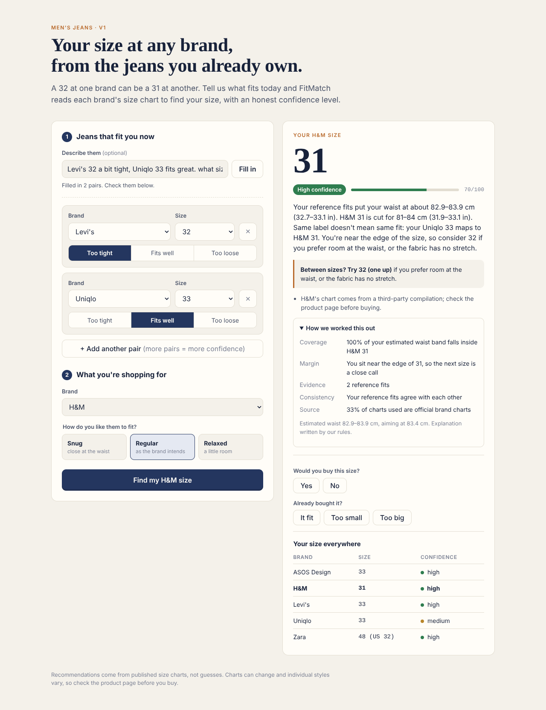
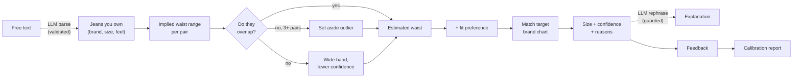

# FitMatch

**Your jeans size at any brand, from the jeans you already own.**

A 32 at Levi's is a 31 at H&M and a 48 at Zara. FitMatch reads each brand's size chart, works out where your waist actually sits from the jeans that fit you today, and tells you what to order elsewhere, with a confidence level that's designed to be checked against real outcomes.



> **Portfolio note:** I built this as a product case study. The interesting parts are the product decisions, not the code: [PRD](docs/PRD.md) · [Decision log](docs/decision-log.md) · [Data sources](docs/data-sources.md)

---

## The problem

Jeans sizes look standardized but aren't. The number on the label is a brand's choice, not a measurement. Shoppers who know their size at one brand still guess at another, and a wrong guess means a return, a bad fit, or an abandoned cart.

## What it does

- **Tell it what fits:** brand, size, and whether they're too tight, just right, or too loose. Or just type it: *"Levi's 32 but a bit tight, Uniqlo 33 fits great"*.
- **Pick a brand and a fit preference** (snug, regular, relaxed).
- **Get a size, a confidence level, and the reasoning**, including "same label doesn't mean same fit" and a between-sizes suggestion when you're near an edge.
- **See your size at every supported brand.**
- **Tell it whether you'd buy it, and later whether it fit.** That feedback powers a calibration report.

Supported: Levi's, ASOS Design, Uniqlo, Zara, H&M (men's jeans).

## Key product decisions

**1. The AI doesn't pick your size.** Asking an LLM "what's my Zara size?" gets a confident answer whether or not it knows the chart. Here, size charts are structured data and matching is deterministic. AI handles only the fuzzy jobs: parsing free text and phrasing the explanation. ([D1](docs/decision-log.md#d1-the-model-doesnt-pick-the-size))

| Job | Who does it |
|---|---|
| Size charts | Curated JSON, schema-validated |
| Estimating your waist, picking the size, scoring confidence | Deterministic engine |
| Understanding "Levi's 32, a bit tight" | LLM (rule-based fallback) |
| Writing the explanation | LLM, checked by a faithfulness guardrail (rule-based fallback) |

**2. Confidence is computed, then held accountable.** The score combines how much of your estimated waist the size covers, whether you're near a size boundary, how many reference fits you gave, whether they agree, and whether the charts are official. The north-star check is **calibration**: do high-confidence picks fit more often than low-confidence ones? If not, the score is decoration. ([D4](docs/decision-log.md#d4-confidence-comes-from-the-data-and-is-measured-against-outcomes))

**3. Real input, not idealized input.** Most people don't own perfectly fitting jeans, so "too tight" and "too loose" are first-class inputs. If your reference fits disagree, FitMatch sets aside the outlier and says which one. ([D3](docs/decision-log.md#d3-tight-and-loose-are-inputs-not-just-fits), [D5](docs/decision-log.md#d5-when-references-disagree-set-aside-one-outlier-then-fall-back))

**4. The explanation can't contradict the answer.** A model-written explanation is only shown if it names the recommended size and no other size the engine didn't produce. ([D7](docs/decision-log.md#d7-the-llm-explanation-has-a-faithfulness-check))

## How it works



## Success metrics

| | Metric | Target |
|---|---|---|
| North star | Post-purchase fit rate | ≥ 80% |
| Leading | "Would you buy this size?" | ≥ 70% yes |
| Trust | Fit rate high > medium > low confidence | Monotonic, ≥ 15 pt gap |
| Guardrail | LLM explanations rejected by the faithfulness check | < 5% |

Run `npm run calibration` to see the report from collected feedback.

## Validation status

v1 is built; user validation is next. The plan (in the [PRD](docs/PRD.md#9-validation-plan)): a 15–20 person survey, a 5-person concierge test using the same charts by hand, then 20–50 testers with a two-week follow-up on purchase outcomes.

## Run it

```bash
npm install
npm run dev          # http://localhost:3000
npm test             # 31 tests: engine, parser, guardrail, calibration
npm run typecheck
npm run calibration  # report from .data/feedback.jsonl
```

AI features are optional. Without an API key, FitMatch uses its rule-based parser and explanations. To enable the model, copy `.env.example` to `.env.local` and set `ANTHROPIC_API_KEY`.

## Project structure

```
data/brands/          Size charts (JSON) with source + retrieval date
src/lib/schema.ts     Zod schemas for charts, requests, feedback
src/lib/charts.ts     Loads and normalizes charts (points -> ranges)
src/lib/engine.ts     Waist estimation, size matching, confidence
src/lib/ai.ts         Free-text parsing + explanation, with fallbacks and guardrail
src/lib/feedback.ts   Feedback storage + calibration
src/app/              Next.js UI and API routes
scripts/              Calibration report
tests/                Vitest suites
docs/                 PRD, decision log, data sources
```

## What's next

1. Hosted feedback storage (Supabase) so a public deployment can collect outcomes
2. Verify the three third-party charts against live product pages
3. Per-style charts (e.g. Levi's 501 vs 511) if misses cluster by style
4. Women's jeans: the bigger and harder problem

## Limitations

Brand-level charts only, waist only, and three of five charts come from third-party compilations (labelled in the app). Charts change; check the product page before you buy.

## License

MIT
